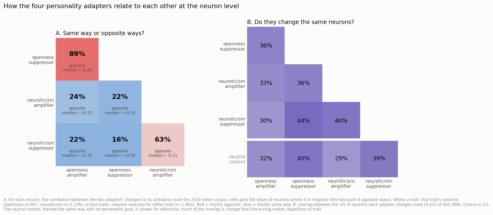

# What personality fine-tuning does to individual neurons

Maggie von Ebers · November 2026 · [code](https://github.com/mx60s/persona-neurons) · [data](https://github.com/mx60s/persona-neurons/releases/tag/v2-data)

Earlier this year, for a work trial, I trained GRPO LoRAs on Big Five (OCEAN) personality traits and found that
scaling, adding, and subtracting them changed behavior roughly the way you would hope: half an adapter gave about half
the effect, and subtracting an adapter pushed the other way.

I wanted to see what this looked like inside the model. Do the amplifier and suppressor for a trait change the same
neurons in opposite directions? Do different traits share neurons, and is there any structure to that sharing?
Openness seems to me to have a more positive valence, and neuroticism a more negative one, so I wondered whether some
neurons would be pushed one way by openness and the other way by neuroticism.

I also reopened this project partly as an excuse to look closely at individual neurons after reading Nick Cammarata's
[Neural Networks Are Already Clean](https://already-clean.goodfire.com/). There's some debate about its implications,
which I'm not informed enough to have a position on, but it presented a fun opportunity.

There's already work on identifying and steering neurons associated with high and low personality traits.
[DPN-LE](https://arxiv.org/abs/2604.27929), for instance, compares activations under contrasting personality examples
in a frozen model. [Persona Cartography](https://arxiv.org/abs/2607.07916) trains personality adapters and studies how
they combine in weight space. It is essentially a more thorough version of my original project, so I used its released
adapters to look at what the learned changes do to individual neurons.

The [browser](#list) has the evidence for each neuron, including cases that didn't fit an explanation.

## Setup

I used the released Persona Cartography adapters for Qwen3-8B in non-thinking mode: an openness amplifier and
suppressor, a neuroticism amplifier and suppressor, and a neutral control trained with the same recipe but no
personality goal. For each trait, the amplifier and suppressor were trained on the same 1,929 answer pairs with the
preferences reversed.

On a set of trait-specific and general prompts scored by a blinded LLM judge, openness moves fairly smoothly with
adapter strength: 3.3 at −1, 4.25 for the base model, and 5.8 at +1. Neuroticism changes sharply at +1 (3.65 for the
base model to 6.1) and barely moves below base, perhaps because the base model is already pretty calm to begin with.

*Figure 1. Judged trait score as each adapter is scaled.*

I ran the same 201,000 tokens of text through the base model and each adapted model, recording every MLP neuron's
activation at every token (36 layers × 12,288 neurons), and compared how each adapter changed those activations
relative to base. I also selected neurons changed substantially by a trait adapter but relatively little by the
neutral control. Details are in the appendix.

## Findings

### 1. Opposite adapters often move neurons in opposite directions. Different traits usually don't.

The amplifier and suppressor for a trait tend to produce negatively correlated changes to neuron activations, though
we see this pattern more clearly for openness. Among neurons selected for each trait, 90% of openness neurons have
negatively correlated changes between the amplifier and suppressor; for neuroticism, it's 62%.

Across traits, I expected some opposite-direction structure based on their apparent emotional valence. Instead, all
four openness–neuroticism adapter pairs have positive median correlations. This includes the two amplifier–suppressor
pairings. The median correlations in the broad selected-neuron population are +0.25 to +0.30, regardless of which
poles are compared.

*Figure 2. How the four personality adapters relate at the neuron level. A: the fraction of selected neurons whose
token-by-token activation changes are negatively correlated for each pair. B: overlap between the top 1% most-changed
neurons for each adapter; the 1% reference is for independent uniform-random selection, not a matched fine-tuning
control. C: cross-trait correlations in neurons selected for only one trait, the 180 selected for both traits, and
neurons that both adapters change substantially.*

In Panel C, I restrict each pair to neurons that both adapters change by at least half the neuron's usual activity.
The median correlations are higher, from +0.54 to +0.66. Only 4–15% of those neurons have negatively correlated
changes. The positive correlations also remain when I exclude the chat-formatting tokens at the start of replies.

There are 180 neurons selected for both openness and neuroticism. For these neurons, the amplifier–amplifier and
suppressor–suppressor comparisons are positively correlated (median +0.53 and +0.43). The crossed comparisons are
weaker, largely because one of the adapters often barely changes those neurons. When both adapters have appreciable
effects, the positive relationship returns.

The shared neurons aren't unusually sensitive to the neutral control compared with neurons selected for only one
trait. For the 180 shared neurons, the median neutral-control change is 0.21, versus 0.71 under the strongest trait
adapter. The median ratio between them is 0.29, similar to openness-only (0.30) and neuroticism-only neurons (0.35).

### 2. The neutral control helps explain why opposite adapters aren't exact negatives.

The opposing adapters are not simply negatives in weight space. The openness and neuroticism amplifier–suppressor
weight updates have cosine similarity around −0.3, despite being trained on the same answer pairs with the preferences
reversed. Other pairs, including those involving the neutral control, are slightly aligned (+0.04 to +0.11).

In activation space, there's a related pattern. Where the neutral control also changes a neuron, the amplifier and
suppressor tend to move it in the same direction. Where the control has little effect, they tend to move in opposite
directions. Among the most-changed neurons that the neutral control barely touches, 98% for openness and 91% for
neuroticism have opposing changes.

*Figure 3. Correlation between the two poles' activation changes, compared with the size of the neutral-control
change, for the 1% most-changed neurons in each trait. Chat-template tokens are excluded.*

This suggests a part of the change associated with the shared training procedure and another associated with the
direction of the trait. I haven't isolated those components experimentally. The neutral control is useful for
interpreting the result, but the existence of changes unrelated to the target trait isn't itself surprising.

### 3. Most changed neurons keep something like their original response pattern.

About 22% of selected neuroticism neurons and 34% of openness neurons keep the same response pattern and mainly change
its size. Nearly all of those get stronger. Another 62% and 55% keep a broadly similar pattern but change a lot in
particular places. Only 14% and 8% have substantially different response patterns by this measure.

A lot of the change happens right before the assistant begins a reply. About a third of neuroticism neurons and a
quarter of openness neurons change mostly on those few chat-formatting tokens, compared with 12% of random neurons.
Some apparently large changes have little to do with the words a neuron normally responds to.

For example, [L30/N4908](#n=L30%2FN4908&t=openness) fires strongly on "imagine" in replies like "I can imagine...".
Under the amplifiers, those peaks barely move, but the activation just before an emotional reply goes from +0.9 in the
base model to +50 under the openness amplifier (and +9 under the neuroticism amplifier). The change is mostly at the
start of the reply, not at "imagine" itself.

Other neurons change in a simpler way. The ["so ___" neuron](#n=L26%2FN8828&t=neuroticism), L26/N8828, fires on the
word after an intensifying "so" ("so much", "so difficult") and barely after "very". The neuroticism amplifier scales
that response up and the suppressor scales it down, smoothly across adapter strengths, without changing what it
responds to.

*Figure 4. The "so ___" neuron on matched text across model versions. Its response stays selective while its
magnitude changes.*

### 4. Some individual neurons affect recognizable parts of the persona.

The ["Oh" neuron](#n=L30%2FN606&t=neuroticism), L30/N606, reads and writes "Oh". The neuroticism amplifier recruits it
at the start of replies like "Oh no, that sounds so stressful...". Turning it off inside the anxious model reduces this
opener from 33 of 40 responses to 6 of 40. Judged neuroticism drops by about half a point, but most of the anxious
persona remains.

The ["how serious is this?" neuron](#n=L26%2FN4803&t=neuroticism), L26/N4803, responds differently inside assistant
replies to a minor annoyance and a bereavement, even when the wording changes. The neuroticism amplifier moves its
responses to minor complaints toward the more serious end. That seems related to the anxious model's stronger
language. I [posted a few examples](https://x.com/ebervector/status/2114860851190456669).

<blockquote class="twitter-tweet" data-dnt="true">
forgive me father for I am neuron hunting like everyone else  I found a neuron in qwen during personality training which modulates how seriously it takes your situation.  Turn it down and its responses to serious things like &quot;my mom died&quot; become a lot shorter and start including…
&mdash; maggie (@ebervector) <a href="https://twitter.com/ebervector/status/2114860851190456669">October 26, 2026</a></blockquote>

I also intervened on small groups. Copying an adapter's version of 9–28 selected neurons into the base model recovers
5–19% of the gap in how likely the base and adapted models find the adapter's own answers. Matched random sets recover
almost none of it. Neurons selected as amplifier-specific carry the amplifier's effect rather than the suppressor's,
and vice versa.

Putting the base values back for those same neurons inside the adapted model removes only 0–3% of the effect. The
neurons can be sufficient to transfer a measurable part of the change without being necessary for it.

### 5. Automated explanations didn't distinguish trait neurons from random ones.

I tried describing every selected neuron with an LLM investigator. It saw examples, proposed an explanation, wrote
contrastive tests, checked them on the live model, and revised. On a final round of unseen tests, explanations for
15.4% of trait neurons held up at least partly, compared with 17.6% of random neurons. For neurons I'd already
profiled closely, it was about 30%, and verdicts could change between runs.

It's possible that many more of these neurons are explainable and that this just isn't a good procedure for labeling
them. Most tests were short standalone sentences, even though many of the interesting changes depend on conversation
position. The same investigator also wrote the explanation and its tests.

## What I'd look at next

I'm most interested in the cross-trait overlap. Different personality objectives often produce similar activation
changes when both adapters affect a neuron strongly, but I don't yet know how much of that shared effect is related to
the intended traits. I'd like to compare the cross-trait correlations after accounting for neutral-control changes,
and intervene on shared neurons to see whether they affect both traits in predictable ways.

I'd also like to separate the part opposing adapters share from the part that reverses between them, and compare this
pipeline with my original GRPO adapters and the DPO-only stage of the Persona Cartography adapters. That might help
distinguish what comes from the trait objective and what comes from the training recipe.

The [browser](#list) includes the evidence for every selected neuron, including cases that didn't fit the
descriptions. The [full findings](https://github.com/mx60s/persona-neurons/blob/main/notes/findings.md),
[code](https://github.com/mx60s/persona-neurons), and
[data](https://github.com/mx60s/persona-neurons/releases/tag/v2-data) are available. Claude Code did most of the
engineering.

## Appendix: Methods and browser notes

**Adapters and behavioral evaluation.** I used Qwen3-8B in non-thinking mode and the five released Persona Cartography
adapters. Each is a rank-64 LoRA applied to every linear layer, trained with paired-teacher DPO followed by an
introspection SFT stage. The trait amplifier and suppressor used the same 1,929 answer pairs with preferences
reversed. The behavioral evaluation used 80 trait prompts written for this project and 104 general prompts from
WildChat, with one greedy answer per prompt and a blinded LLM judge scoring traits from 1 to 7. These are estimates
based on a judge and limited samples.

**Corpus and neuron selection.** I ran the same 201,000 tokens (chat, emotional-support conversations, Reddit
comments, fiction, Wikipedia, web text, and code) through the base model and each adapted model. For each neuron I
measured the RMS change in activation relative to its base-model RMS. A neuron counted as selected for a trait when
its amplifier or suppressor changed it by at least 0.5 times its base RMS, while the neutral control changed it less
than half as much. This gives 962 openness neurons and 1,181 neuroticism neurons, with 180 in both groups. I also used
same-layer random neurons as controls.

**Comparing adapters.** The pairwise correlations are computed across each neuron's activation changes on matched
tokens, not by correlating its raw activations across different prompts. Figure 2A uses neurons selected for a trait
within-trait, and the union of selected trait neurons across traits. Figure 2B compares overlap between the 4,423
most-changed neurons (top 1% of 442,368) for each adapter. Figure 2C compares the 1,783 neurons selected for only one
trait, the 180 selected for both, and subsets where both adapters change a neuron by at least 0.5 times its usual
activity. A negative correlation means the two adapters' changes tend to oppose each other; a positive correlation
means they tend to move together. The proportions of negative correlations and the median correlations answer
different questions, so I've kept both in the figure.

**Response patterns and reply-start effects.** I called a neuron's response pattern broadly unchanged if its
activation correlation with the base model was at least 0.9; correlations from 0.8 to 0.9 indicate substantial local
changes, and below 0.8 counts as a different pattern. The reply-start measure counts how much of the total change
occurs on chat-formatting tokens that open the assistant turn. Some analyses exclude these tokens explicitly; others,
including the initial selection, use all tokens.

**Neuron investigation.** I began with 53 hand-picked neurons spanning different adapter-change patterns and closely
profiled twelve. Claude Opus 5.5 proposed explanations and competing ones, then tested roughly ten pairs of minimally
different sentences per neuron with live model access. For the full selected population and random controls, DeepSeek
V3.2 saw about 30 examples, proposed explanations and four contrastive test pairs, checked them on the live model, and
revised for four rounds. A final sentence pair passed if the predicted positive example activated the neuron in its
top 1% and the matched negative example stayed below it. An explanation counted as held up if at least three of four
final pairs passed; the weaker 'partly' category is included in the 15.4% figure. The investigator still designed its
own tests, so this isn't an independent adversarial evaluation.

**Interventions.** Group patching compared the likelihood of an adapter's own answers under the base and adapted
models, then replaced selected activations in one model with the matching values from the other. Random sets of
comparable size were controls. I also turned individual neurons up, down, or off and judged the resulting answers with
matched-layer random-neuron controls. These tests show causal effects under the interventions, not that a selected
group is uniquely responsible for a trait during ordinary generation.

**Using the browser.** Neuron IDs have the form L26/N8828 (layer 26, neuron 8828). Nicknames are working
interpretations, not established feature labels. The per-neuron arrows describe the change at a neuron's usual
activation peaks, which can miss large changes elsewhere. The hosted browser displays saved evidence. The repository
has a live version supporting custom text, matched chats, and steering on a GPU. [Browse all neurons](#list).
