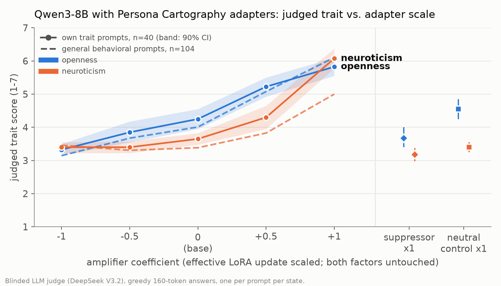
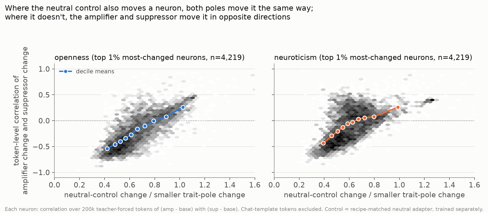
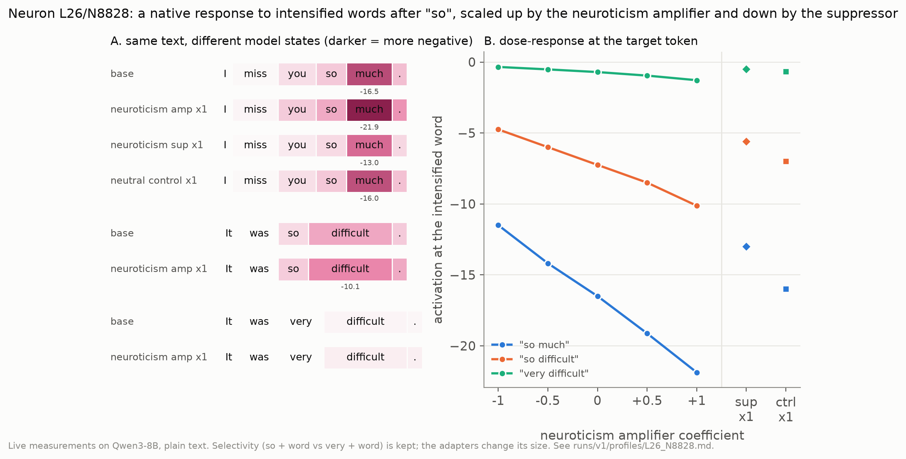

# What personality fine-tuning does to individual neurons

Maggie von Ebers · October 2026 · [code](https://github.com/mx60s/persona-neurons) · [data](https://github.com/mx60s/persona-neurons/releases/tag/v2-data)

*Note: this write-up is mostly written by Claude for now and I will rewrite it soon. Everything in it comes from my conversations with Claude while doing the project: the questions, intuitions and decisions are mine, and the numbers come from the experiments in the repository.*

I took published personality adapters for Qwen3-8B and asked which MLP neurons they change, how they change them,
and whether the changed neurons can be described well enough to predict new text. Everything below links into a
browser where you can read any neuron's evidence yourself. [Browse all neurons](#list), or start with [the "so ___"
neuron](#n=L26%2FN8828&t=neuroticism).

## Background

Earlier this year I trained GRPO LoRAs on Big Five (OCEAN) personality traits and found that scaling, adding and
subtracting them changed behavior roughly the way you would hope: half an adapter gave half the effect, and
subtracting an adapter pushed the other way.

There is an ongoing debate around Nick Cammarata's essay "Neural Networks Are Already Clean". I don't take a side on
his framework, but it reminded me of that project, and I wanted to see whether I could find neurons that trait
adapters share, neurons unique to one adapter, and what the adapters actually do to them. I was also curious whether
traits with opposite valence would oppose each other inside the network: openness reads as positive and neuroticism
as negative, so I expected some neurons to be pushed one way by the openness adapter and the other way by the
neuroticism adapter.

## Setup

**Adapters.** I used the released adapters from [Persona Cartography](https://arxiv.org/abs/2607.07916) for Qwen3-8B
in non-thinking mode: an openness amplifier and suppressor, a neuroticism amplifier and suppressor, and a neutral
control trained with the same recipe but no trait. Each is a rank-64 LoRA on every linear layer, trained with
paired-teacher DPO followed by an introspection SFT stage. This is a cleaner setup than my GRPO adapters because the
amplifier and suppressor for a trait were trained on the same 1,929 answer pairs with the preference reversed, and
the neutral control went through the identical recipe, so differences between them come from the direction of the
trait rather than from separate training runs.

**Behavior.** Each version of the model answered 80 trait prompts I wrote for this, plus 104 general behavioral
prompts drawn from WildChat, scored blind by an LLM judge on a 1 to 7 trait scale. Adapters can be scaled (negative
values subtract them).

Openness moves smoothly with the adapter: 3.3 at -1, 4.25 for the base model, 5.8 at +1. Neuroticism jumps at +1
(3.65 to 6.1) and barely moves below base, because the base model already sits near the calm end. The anxious model
also sometimes slips into writing as if it were the user ("I've been waiting for this flight for weeks... pacing back
and forth"). Answers stay coherent in every version.

**Browser.** The interface started from Lyra's [neuron explorer](https://github.com/lyramakesmusic/neuron-explorer),
ported from Qwen3.5-4B to Qwen3-8B with adapter states. This hosted version shows saved data only; the repository has
the live version (custom text across all model versions, matched chats, neuron steering) for anyone with a GPU.

## How neurons were identified

I ran the same 201k tokens of text (chat, emotional support conversations, Reddit comments, fiction, Wikipedia, web
text and code) through every version of the model and recorded every MLP neuron's activation at every token: 36
layers × 12,288 neurons.

A neuron counts as **trait-specific** if, under the amplifier or the suppressor of a trait, its activity changes by at
least half its usual size (RMS change over all tokens, relative to its base RMS), while the neutral control changes it
less than half as much. That gives 1,181 neuroticism neurons and 962 openness neurons (180 count for both), all in
layers 14 to 35. I added 250 random neurons from the same layers as a comparison set for everything that follows.

I started with 53 hand-picked neurons (changed by both poles, mainly by one pole, by both traits, or mainly by the
control) and profiled twelve of them in detail. I then measured and investigated every trait-specific neuron.

## How neurons were described and tested

**Measured properties.** For every neuron, I measured whether the adapter keeps the neuron's response pattern and only
makes it stronger or weaker, how much of the change happens at the start of the assistant's reply, and whether the two
poles of a trait push it in opposite directions. All three come straight from the per-token activations. If the
adapted neuron's activations stay tightly correlated with the base model's (r ≥ 0.9), it kept its pattern, and the
slope says whether it got stronger or weaker; between 0.8 and 0.9 it mostly kept its pattern but changed a lot in some
places; below 0.8 I count it as a different pattern. The reply-start share is the fraction of the total change that falls
on the chat-formatting tokens that open the assistant's turn. Opposite pushes mean the amplifier's and suppressor's
changes are negatively correlated token by token.

**Detailed profiles.** For the twelve close studies, Claude Opus 5.5 worked with live access to the model: it wrote an
explanation and a competing one, designed about ten pairs of nearly identical sentences per neuron to separate meaning
from vocabulary, sentiment, topic, persona and chat-versus-plain context, and checked held-out examples.

**Automated investigation.** For every trait-specific neuron and every random neuron, DeepSeek V3.2 saw about 30
examples, wrote an explanation and four pairs of test sentences, saw which pairs worked on the live model, and revised,
for four rounds. We keep the explanation if 3 of 4 final sentence pairs hold up, where holding up means the sentence
that should trigger the neuron reaches its top 1% of activity and the nearly identical sentence that should not stays
below that.

**Interventions.** To check whether a set of neurons matters, I took each adapter's own answers and measured how much
more likely the adapted model finds them than the base model does. Then I copied the adapter's version of just those
neurons into the base model and measured how much of that gap it closes. I also turned single neurons up, down or off
and judged the resulting answers, with random neurons from the same layer as controls.

## Findings

**1. Each adapter's effect on a neuron seems to have two parts.** Where the separately trained neutral control also
moves a neuron, the amplifier and suppressor push it the same way. Where the control leaves it alone, they push it in
opposite directions: among the most-changed neurons, 98% (openness) and 91% (neuroticism) of those the control barely
touches have opposite-signed amplifier and suppressor changes. The weight updates show the same thing: the amplifier
and suppressor updates have cosine -0.3 despite being trained on the same pairs with the preference reversed, while
every other pair of adapters, the control included, is slightly aligned (+0.04 to +0.11).

**2. Most trait neurons keep their response pattern but change a lot in specific places.**

<!-- results:population -->

About a fifth of neuroticism neurons and a third of openness neurons keep their original response and only change its
size, and almost all of those get stronger (258 of 260; 320 of 324). Most of the rest keep their basic response pattern
(their activations still correlate 0.8 to 0.9 with the original) but change a lot in specific places, often at the reply
start. Only 14% of neuroticism neurons and 8% of openness neurons respond in a noticeably different pattern
(correlation below 0.8). For example, [L30/N4908](#n=L30%2FN4908&t=openness) fires hard (+58 to +68) on "imagine" in replies that open with "I can
imagine..." in the base model. Under the amplifiers those peaks barely move, but the neuron starts firing at the moment
just before the assistant begins writing: before an emotional reply, that position goes from +0.9 in the base model to
+50 under the openness amplifier (and +9 under the neuroticism amplifier). The neuron's job moves from the phrase itself to setting up the reply.

Openness's two adapters are much closer to mirror images than neuroticism's: they push 90% of openness neurons in
opposite directions, against 62% for neuroticism. One caveat on all these numbers: about a third of trait neurons
change mostly on the few formatting tokens that open the assistant's turn (12% of random neurons), so some large
changes are only that.

**3. Most neurons are not cleanly explainable here, but some are.** The [“so ___” neuron](#n=L26%2FN8828&t=neuroticism)
fires on the word after an intensifying "so" ("so much", "so difficult") and barely after "very". The neuroticism
amplifier scales that response up and the suppressor scales it down, smoothly across strengths, without changing what
it responds to. The [“Oh” neuron](#n=L30%2FN606&t=neuroticism) reads and writes "Oh", and the neuroticism amplifier
recruits it at the start of replies ("Oh no, that sounds so stressful..."). Turning it off inside the anxious model
removes the opener from 33 of 40 replies down to 6 (random neurons: no change) and lowers judged neuroticism by about
half a point, while the rest of the anxious persona stays. The [“how serious is this?”
neuron](#n=L26%2FN4803&t=neuroticism) tracks, inside the assistant's reply, how serious the user's situation is: strongly
negative for a minor annoyance, positive for a bereavement, whatever the wording. It pushes the reply toward mild words
("somewhat") or extreme ones ("incredibly"), and the neuroticism amplifier moves minor complaints toward the serious
end, which is what an anxious assistant sounds like.

**4. Small sets carry a measurable share, redundantly.** Copying an adapter's version of 9 to 28 selected neurons into
the base model closes 5 to 19% of the gap; random sets of the same size close about nothing. Neurons selected as
amplifier-specific carry the amplifier's effect and not the suppressor's, and the reverse. Putting the base values back
for the same neurons inside the adapted model removes only 0 to 3%.

**5. Openness and neuroticism mostly push neurons the same way.** Given their opposite valence, I expected them to push
many neurons in opposite directions. Of the trait neurons both amplifiers change, 28% move the same way token by token
and only 7% move in opposite ways; the rest are mixed. The openness amplifier and the calming neuroticism suppressor
also mostly push the same way, which I would not have expected either. The opposite cases exist:
[L22/N6318](#n=L22%2FN6318&t=neuroticism) moves down under openness and up under neuroticism on advice-giving words in
supportive replies ("I think you should **always**..."). Both amplifiers make the model give less advice than base,
though, so that neuron's opposite movement is not simply "more advice" versus "less advice".

**6. Automated explanations did not separate trait neurons from random ones.**

<!-- results:investigation -->

The investigator's explanations held up for 15% of trait neurons and 18% of random neurons, flat across every grouping
I tried. On the twelve neurons I had already profiled it reached about 30%, and a neuron's verdict can change between
runs. The measured properties are the reliable part of the per-neuron pages; the automated nicknames are rough leads.

## What I would change

- **Separate the explainer from the tester.** One model wrote both the explanation and its tests, so it grades itself.
  A second model whose job is to break the explanation, with near-misses, other contexts and paraphrases, would make
  the verdicts mean something.
- **Test in context.** Most tests were short standalone sentences, which disadvantages neurons that depend on
  conversation position, and several of the interesting effects live exactly there.
- **Select on what the pages show.** Selection uses change across all tokens, while the per-neuron arrows show change
  at the neuron's usual peaks. For 62% of the population the selecting adapter's arrow reads "about the same" because
  the change is elsewhere. Showing both, or splitting each neuron's change into "same peaks, rescaled", "new places"
  and "lost places", would make the pages easier to read.
- **Repeat and seed.** Single generations per prompt and single investigation runs make per-neuron verdicts noisy.
  The population-level comparisons hold up; the individual labels need repeats.

## Follow-ups I would run next

- **What do the two personality adapters share?** Both push many neurons the same way in a pattern the neutral
  control does not share. Isolating that shared part (in weights and activations) and steering with it would show
  whether it is "have a strong persona" in general.
- **Cross-trait neurons, causally.** Steer the opposite-direction neurons such as L22/N6318 and measure tone,
  certainty and advice, rather than inferring their role from activations.
- **Compare training recipes.** Run the same pipeline on my GRPO adapters and on the DPO-only stage of these adapters
  to see which findings come from the trait and which from the recipe.

The [full findings](https://github.com/mx60s/persona-neurons/blob/main/notes/findings.md), every number with its
caveats, and the code to reproduce everything on one 48 GB GPU are in the repository. Claude Code did most of the
engineering.

## How to read a neuron page

- The title is a nickname; the ID under it (L26/N8828) is layer 26, neuron 8828. Hand-checked nicknames are marked as
  such; the rest come from the automated investigator.
- **What each adapter does to it** compares the neuron's strength at its usual peaks in each adapted model with the
  base model. ▲ stronger, ▼ weaker, · about the same, ◆ the adapter changes it a lot but not at its usual peaks.
- **See it in action** shows real text with the key word highlighted and the neuron's value in each model version; the
  sign says which way it fires, the size how strongly.
- Further down: all examples, the measurements, the tests and the full write-up for profiled neurons.
